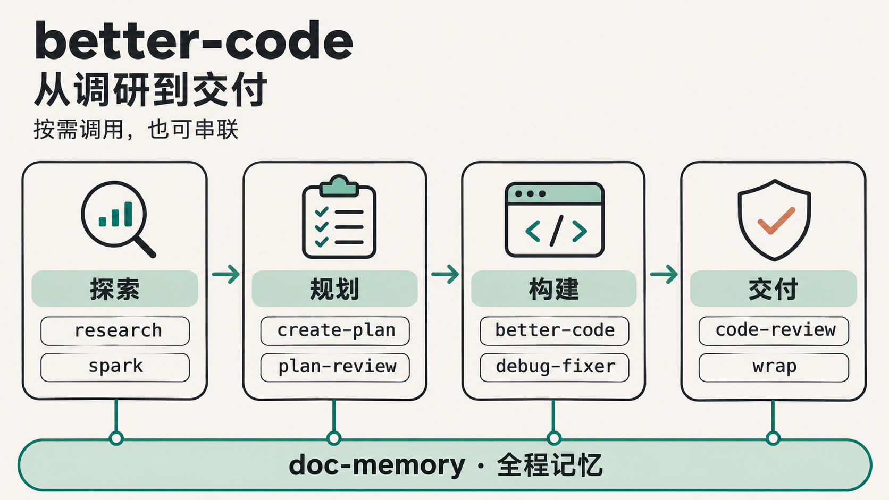

# better-code

**让 AI 写出更好的代码。**

better-code 是一个 Claude Code 插件，把模块设计、编码规范与代码审查融入开发过程，帮助 AI 写出职责清晰、便于扩展、有验证依据的代码。

如果你用 AI 开发功能时，经常发现一个函数包揽所有事情、同一条规则散落在多个文件、加一种功能就要修改整条调用链，better-code 会引导 Claude 先理清职责与边界，再落实实现、测试和审查。目标很具体：**这次功能做对，下次修改也有清楚的入口。**

[快速开始](#快速开始) · [什么是更好的代码](#什么是更好的代码) · [按任务选择技能](#按任务选择技能) · [使用说明](#使用说明)

## 快速开始

### 安装

在 Claude Code 会话中，先添加 marketplace，再安装插件：

```text
/plugin marketplace add bb-boy680/better-code
/plugin install better-code@better-code
```

Claude Code 2.1.275 及以上也支持合并为一条命令：

```text
/plugin install better-code --marketplace bb-boy680/better-code
```

### 从一个功能开始

在你的项目目录启动 Claude Code，用 `/better-code:better-code` 描述要实现的功能。例如，为已有订单列表增加导出能力：

```text
/better-code:better-code 为订单列表增加 CSV 导出。
复用现有查询和权限校验，将导出流程与格式编码分开，补齐相关验证。
```

这个技能会先查看现有代码、调用方和依赖，再按任务复杂度完成必要的设计与实现。交付时应说明改了哪些文件、职责如何划分、运行了哪些检查，以及哪些内容尚未验证。

**小改动可以直接开始。** 已有计划时传入计划路径；涉及较大改造或需要验证的技术假设时，再先规划。你不需要每次都走完全部技能。

## 什么是更好的代码

better-code 将代码质量落实为可以检查的要求：

| 关注点 | 写代码时的要求 |
| --- | --- |
| 模块边界 | 按职责组织代码，让一起变化的规则放在一起 |
| 业务规则 | 校验、状态迁移和执行顺序各有明确的归属 |
| 类型与错误 | 在边界校验输入，明确业务结果与异常的处理责任 |
| 现有能力复用 | 先检查项目实现和依赖版本，复用适合的模块与 SDK |
| 加载与执行 | 核对重模块是否按需加载、重计算是否阻塞主线程 |
| 验证与维护 | 检查功能行为，也检查下一次同类修改要改哪里 |

设计的规模应与问题相称：职责清楚的小功能可以用简单函数实现；出现多种格式、复杂状态或外部协议差异时，再选择对应的抽象方式。

### 例如：给导出功能增加一种格式

假设项目已经支持 CSV 导出，现在需要增加 JSON。可以先明确三个职责：

- **导出用例**：负责查询、编码、写入的顺序，以及失败或取消后的清理。
- **格式实现**：只负责把数据编码成 CSV 或 JSON。
- **数据与存储接口**：复用已有查询和写入能力。

一种可能的目录组织如下，具体仍以项目现有结构为准：

```text
export/
├── export-report.ts    # 导出用例：顺序、状态与清理
├── formats/
│   ├── csv.ts          # CSV 编码
│   └── json.ts         # JSON 编码
└── export-report.test.ts
```

验收时除了确认 JSON 能正确导出，还要检查：调用方是否确实走统一的导出流程，原有 CSV 行为是否保持，UI 或控制器中是否仍保留另一套状态与清理逻辑。

**下次增加格式时，变化应集中在格式实现与必要的选择入口。** 如果还需要在多个地方复制查询、校验和清理规则，模块边界就需要继续调整。相关标准见 [better-code 技能](skills/better-code/SKILL.md)。

<details>
<summary>查看开发与维护中的几个对比</summary>


</details>

## 按任务选择技能

插件提供 9 个技能，围绕代码设计、实现和验证按需组合。调用格式为 `/better-code:<技能名> <任务描述>`；点击名称可查看完整规则。

| 你现在要做什么 | 技能 | 主要产物 |
| --- | --- | --- |
| 实现功能或重构模块 | [better-code](skills/better-code/SKILL.md) | 代码改动、行为与结构验证 |
| 把模糊需求变成清楚的设计 | [spark](skills/spark/SKILL.md) | 设计规格与关键决定 |
| 查找成熟方案、SDK 与实践 | [research](skills/research/SKILL.md) | 有来源的调研与方案比较 |
| 拆解较大的开发任务 | [create-plan](skills/create-plan/SKILL.md) | 模块划分、实施步骤与验收计划 |
| 检查实施方案是否合理 | [plan-review](skills/plan-review/SKILL.md) | 风险、缺口与修订建议 |
| 审查已经写出的代码 | [code-review](skills/code-review/SKILL.md) | 有触发条件和证据的审查结论 |
| 定位运行中的异常 | [debug-fixer](skills/debug-fixer/SKILL.md) | 根因证据、修复与验证记录 |
| 完成验证后的收尾 | [wrap](skills/wrap/SKILL.md) | 计划归档、提交与按需合并清理 |
| 留下可复用的工程经验 | [doc-memory](skills/doc-memory/SKILL.md) | 分类索引与独立经验条目 |

例如，重构已有代码：

```text
/better-code:better-code 重构报表导出模块，集中状态与清理逻辑，保留已有功能。
```

或者审查一次已经完成的修改：

```text
/better-code:code-review 检查当前改动的模块边界、重复规则、错误处理和回归风险。
```

`code-review` 默认只读。需要修改代码时，明确提出修复或重构任务。

## 复杂任务怎样衔接

对于新产品、跨模块改造或技术路线不明确的需求，可以将技能串联：

```text
research → spark → create-plan → plan-review → better-code → code-review → wrap
```

调研帮助找到可复用的方案，设计和计划明确边界，编码负责把决定落实到真实调用路径，审查与收尾核对交付。`doc-memory` 用于按需读取和记录工程经验；排查运行时异常时可调用 `debug-fixer`。



已有审核通过的计划，可以直接交给编码技能。将下面的路径替换为项目中的真实计划文件：

```text
/better-code:better-code docs/plans/report-export.md
```

需要隔离当前工作区时，可显式指定 `worktree`：

```text
/better-code:better-code worktree docs/plans/report-export.md
```

默认在当前工作目录工作。`worktree` 模式会创建或进入独立工作树；任务验证完成后，再按项目约定处理提交、合并与清理。

<details>
<summary>运行时异常：按证据定位问题</summary>

当问题需要通过复现和日志确认时，`debug-fixer` 提供受控插桩、证据分析、修复验证和调试代码清理流程。若发现根因涉及职责耦合或状态分裂，则先转入重构规划。

```text
/better-code:debug-fixer 快速切换文档时，偶发旧请求结果覆盖当前文档，请定位原因并验证修复。
```

下图只展示运行时取证路径；完整分流规则见 [debug-fixer](skills/debug-fixer/SKILL.md)。


</details>

## 使用说明

- **适用环境**：Claude Code 插件。技能会使用当前会话可用的文件、终端和检索工具；调研、浏览器验证等任务需要对应工具支持。
- **明确调用**：示例均使用 `/better-code:<技能名>`。Claude 也可以根据技能描述判断何时加载；需要指定流程时，直接调用更清楚。
- **按项目验证**：技能指导模型实施和检查代码。最终质量仍需结合项目测试、类型检查、构建及人工审查判断，不能把一份说明当作检查已通过的证据。
- **记忆与项目约定**：经验默认保存到 `docs/memory/index.md` 和独立主题文件。需要每次会话先读取时，将这条要求写进目标项目的 `CLAUDE.md`；本仓库根目录的项目规则不会随插件安装自动应用到其他项目。
- **收尾会修改 Git 状态**：`wrap` 在验证通过后处理计划归档和提交，使用工作树时还涉及合并与清理。调用前明确任务范围和目标分支，远程推送另行授权。

<details>
<summary>工作流文档通常保存在哪里</summary>

沿用目标项目已有约定；未指定时使用以下默认位置。只在任务需要时生成对应文档。

| 内容 | 默认位置 |
| --- | --- |
| 调研结论 | `docs/research/` |
| 设计规格 | `docs/specs/` |
| 实施计划 | `docs/plans/` |
| 已完成计划 | `docs/plans/archive/` |
| 工程经验 | `docs/memory/` |
| 排障日志 | `.debug/logs/` |

已归档的计划按只读历史记录对待；后续改造新建计划，并引用历史文档。

</details>

## 本地开发与校验

克隆仓库后，在终端中挂载本地插件目录：

```bash
claude --plugin-dir /path/to/better-code
```

在插件仓库根目录校验结构：

```bash
claude plugin validate . --profile directory
```

插件描述位于 [.claude-plugin/plugin.json](.claude-plugin/plugin.json)，marketplace 配置位于 [.claude-plugin/marketplace.json](.claude-plugin/marketplace.json)，各技能入口为 `skills/<技能名>/SKILL.md`。

## License

[MIT](LICENSE) © 黑黑的脸蛋
