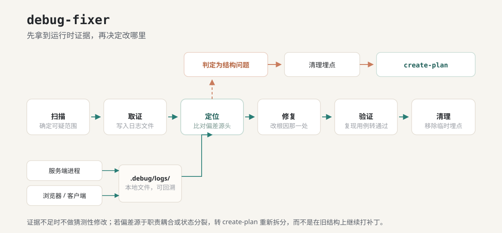
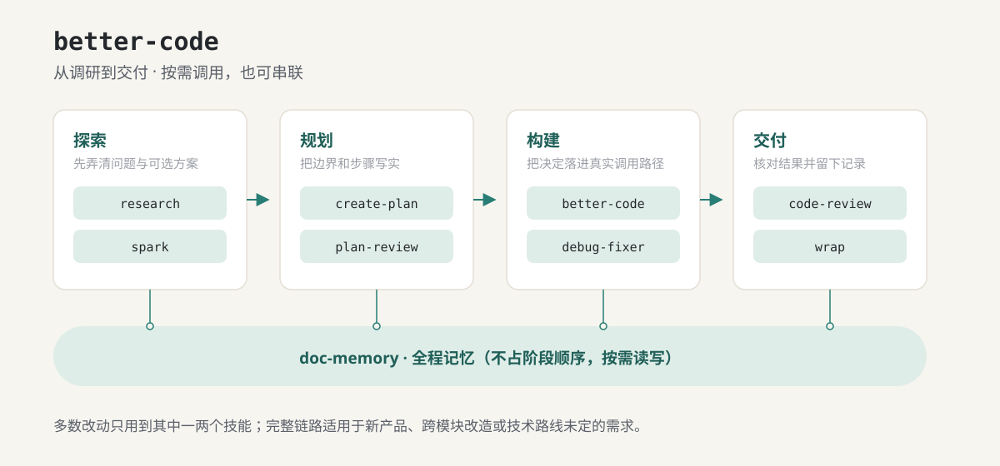

# better-code

**让 AI 写出真正高内聚、好维护的代码，而不是拼凑功能的“胶水代码”。**

现在的 AI 写代码很快，但“写得快”不等于“写得好”。没有工程约束时，AI 往往只是把逻辑拼凑成能跑通的功能：职责散落在各处、多套状态并存、套一层空壳就当封装，等到第二次改需求时不得不翻改四五个文件。同时，思考过程全留在一次性聊天记录里，换个人或开个新会话就得从头交代。

`better-code` 是一套面向 AI Coding Agent 的**高内聚代码质量与全链路工程协作插件**（支持 Claude Code、Codex、Cursor、Windsurf、Cline、GitHub Copilot、Gemini CLI、Kimi Code、Devin、Qoder 等 14+ 宿主），核心做透两件事：

1. **教 AI 怎么写好代码**：在动手前划清模块边界与唯一职责归属，杜绝把逻辑硬凑在一起的胶水代码与透传假封装，用**“下次同类修改要动几个文件”**检验代码结构。
2. **把工程思考沉淀为可协作的文档资产**：从前期的**深度调研（`docs/research/`）**、**头脑风暴与设计规格（`docs/specs/`）**、**分阶段实施计划（`docs/plans/`）**，到收尾后的**只读历史归档（`docs/plans/archive/`）**与**团队工程记忆（`docs/memory/`）**，生成的每一份文档都可以直接交给团队协作者或零上下文的新 Agent 接力执行。


---

## 为什么选择 better-code？（对比 `superpowers` 与 `OpenSpec`）

市面上的主流方案各有侧重：`OpenSpec` 侧重**需求变更文档（Spec）的管理**，但几乎不管代码本身的封装质量，也没有前期技术调研与排障工具；`superpowers` 侧重**强制跑 TDD 微任务与子智能体流水线**，但日常小改动摩擦大、Token 消耗高。

`better-code` 将**“深度的代码封装质量控制”**与**“从调研、设计、计划到归档的完整协作文档流”**合二为一，并且做到了大任务有完整规范、小改动有轻量通道：

| 维度 | `better-code`（本插件） | [`obra/superpowers`](https://github.com/obra/superpowers) | [`Fission-AI/OpenSpec`](https://github.com/Fission-AI/OpenSpec) |
| --- | --- | --- | --- |
| **核心定位** | **高内聚代码封装质量 + 全链路协作文档流 + 实证排障** | **微观 TDD 执行纪律 + 多子智能体自动流水线** | **增量规格文档管理（Spec-Driven Development）** |
| **对“拒绝胶水代码、做好封装”的约束深度** | **极深**：明确约束唯一状态/规则所有者、拦截透传假封装、边界强类型收窄、错误所有权、前端模块化拆分与真按需加载 | **中等**：重点约束“先写失败测试 → 最小实现”的 TDD 循环，对模块封装模式、假封装拦截与前端架构边界约束较浅 | **较浅**：聚焦于定义需求与任务文档格式，对代码如何分层、如何封装、如何处理状态与错误基本不设具体标准 |
| **生成计划、文档与多人协作能力** | **全周期覆盖**：可生成**深度调研报告（`research`）→ 设计规格与淘汰账本（`spark`）→ 零上下文可接手的实施计划与评审（`create-plan / plan-review`）→ 只读历史归档（`wrap`）+ 团队工程记忆库（`doc-memory`）**，天然支持多人与多会话接力 | **偏执行期临时文档**：生成 `specs/` 与 `plans/` 供子智能体按步执行，缺少前置联网技术调研报告、方案淘汰账本与结构化团队经验索引 | **偏需求变更规格**：通过 `proposal / spec / design / tasks` 管理变更并用 Delta Spec 合并回主规格，但不包含前期技术选型调研与跨会话工程踩坑记忆库 |
| **日常开发体验（大任务 vs 小改动）** | **按复杂度自适应**：跨模块改造走“调研→设计→计划→编码”完整闭环；几行代码的局部修改自动走**高可用快速通道**，不搞形式主义 | **流程刚性较强**：技能强触发，哪怕小改动也容易被推着走完完整规划与 2～5 分钟 TDD 微任务拆分，等待时间较长 | **需 CLI 初始化与目录维护**：需先 `openspec init` 并在 `openspec/changes/<id>/` 下维护 4 份文档，小改动仪式感较重 |
| **疑难 Bug 排查与运行时取证** | **自带自动化工具链**：`debug-fixer` 内置本地调试接收服务、受控埋点协议与一键零残留清理脚本，禁止盲猜打补丁 | **纯文本流程指导**：提供 `systematic-debugging` 四步排查规范，无配套自动化日志采证与清理脚本 | **无专门排障机制**：聚焦于需求提案与任务拆解 |
| **Token 消耗与上下文开销** | **极低**：默认主上下文直跑，不乱开子智能体；9 个技能常驻描述合计仅 **~1,047 字符** | **高**：重度依赖 `subagent-driven-development`，每个微任务派发实现子智能体 + 两轮审查子智能体，Token 消耗大 | **低**：按当前 `change-id` 目录局部加载 Markdown 文档 |

---

## better-code 解决哪两个核心问题？

### 一、 让 AI 写出高内聚的好代码，拒绝拼凑式“胶水代码”

AI 最容易犯的错，是把“功能跑通”当成“代码写完”。`better-code` 在编码与审查阶段用四条硬标准把控封装质量：

1. **真封装 vs 假封装拦截**：业务顺序、核心校验规则、状态流转与资源清理必须有**唯一权威所有者**。如果只是新建一个外层模块做透传转发，而旧代码和界面里还留着另一套重复校验与状态（双轨并存），哪怕测试跑绿也判**结构验收不通过**。
2. **清晰的模块与前端边界**：按领域职责组织目录，不在同目录下散装堆放文件；纯前端项目拒绝硬套伪服务端空壳分层，控制单文件体积与职责单一，拦截“外层写动态加载、入口仍被公共索引静态拉入首屏”的假按需加载。
3. **边界强类型与干净的错误处理**：在系统入口一次性完成输入校验与类型收窄，用显式结果类型表达预期内的业务分支；只在真正具备恢复或清理职责的边界捕获异常，拒绝到处乱套错误处理吞掉异常制造“假成功”。
4. **先拿运行时证据再修 Bug（`debug-fixer`）**：遇到复杂故障最多只允许 1 次高把握静态直修；一旦涉及异步竞态或直修未过，立即通过内置调试服务采集运行时日志到 `.debug/logs/`，修完自动零残留清除埋点。如果发现根因是状态散落的结构缺陷，立即停止贴膏药，转入重构规划。



### 二、 生成全链路结构化文档，让多人协作与跨会话交接有据可查

在团队协作或复杂项目里，口头对话无法复审，也没法交接。`better-code` 的每个阶段都能产出结构清晰的 Markdown 文档，直接提交到仓库供团队评审或交给其他人/Agent 继续推进：

| 阶段 | 生成的文档资产与默认位置 | 在多人协作与项目演进中解决什么问题 |
| --- | --- | --- |
| **1. 技术调研**（[research](skills/research/SKILL.md)） | `docs/research/<topic>/`<br>（总报告 + 现成方案对比 + 踩坑清单） | 新项目选型或攻克难点前，跨语言检索开源标杆、成熟 SDK 与社区实战避坑结论，避免团队成员重复踩坑或闭门造轮子 |
| **2. 头脑风暴与设计规格**（[spark](skills/spark/SKILL.md)） | `docs/specs/<topic>.md`<br>（设计规格说明书） | 通过决策树逐层追问把模糊想法收敛成无歧义规格，记录明确不做项、架构草图、默认假设与**淘汰账本（为什么否决方案 B/C）**，防止协作者或后续会话走回头路 |
| **3. 实施计划与架构评审**（[create-plan](skills/create-plan/SKILL.md) / [plan-review](skills/plan-review/SKILL.md)） | `docs/plans/<slug>.md`<br>（分阶段可执行计划与评审记录） | 写清模块化目录树、SDK 复用边界、接口契约与分阶段验收命令；**任何没参与前期讨论的团队成员或新 Agent 拿到文档就能直接按步开发** |
| **4. 封版归档与团队记忆**（[wrap](skills/wrap/SKILL.md) / [doc-memory](skills/doc-memory/SKILL.md)） | `docs/plans/archive/`（只读历史档案）<br>`docs/memory/`（分类索引 + 独立经验条目） | 功能上线后将计划锁定为只读档案留存演进历史；把日常踩坑与团队规约沉淀为按需加载的工程记忆库，让整个团队的 Agent 越用越懂项目 |

---

## 九个技能，按需单调或串联成流水线

日常开发不必每次走满全套流程——多数任务只需调用其中 1～2 个技能；复杂新功能或跨模块重构时再串联使用。调用格式为 `/better-code:<技能名> <任务描述>`：

| 你会这样说 | 调用技能 | 它产出什么 |
| --- | --- | --- |
| 「调研一下这块有没有现成方案或成熟 SDK」 | [research](skills/research/SKILL.md) | 有真实信源的跨语言方案对比、底层机制拆解与避坑报告（`docs/research/`） |
| 「先聊下怎么设计」「帮我理清需求」「盘问我 / 别顺着我」 | [spark](skills/spark/SKILL.md) | 决策树追问、多路线碰撞、淘汰账本与设计规格文档（`docs/specs/`） |
| 「先做个实施计划」「拆解开发阶段」 | [create-plan](skills/create-plan/SKILL.md) | 模块化目录划分、职责与契约定义、零上下文可执行的分阶段计划（`docs/plans/`） |
| 「审一下这个计划能不能开工」 | [plan-review](skills/plan-review/SKILL.md) | 架构封装、性能加载与安全边界诊断，输出分级风险与计划必改清单 |
| 「实现这个功能」「按计划写」「重构这个模块」 | [better-code](skills/better-code/SKILL.md) | 高内聚代码落地、旧重复逻辑退出、行为与结构双验收（支持 `worktree` 隔离开发） |
| 「检查当前代码或 Git diff 有没有 Bug」 | [code-review](skills/code-review/SKILL.md) | 覆盖未暂存、暂存区与新文件，沿真实调用链输出有触发条件和证据的审查结论 |
| 「这里偶发异常 / 报错了，定位一下」 | [debug-fixer](skills/debug-fixer/SKILL.md) | 受控埋点采样（`.debug/logs/`）、根因定位修复与零残留调试代码清理 |
| 「收尾吧」「归档计划并提交 / 合并 worktree」 | [wrap](skills/wrap/SKILL.md) | 计划只读归档（`docs/plans/archive/`）、干净 Git 提交与工作树合并清理 |
| 「记住这条工程规则」「看看项目的踩坑记忆」 | [doc-memory](skills/doc-memory/SKILL.md) | 确定性检查下沉 + `docs/memory/index.md` 分类路由索引与独立经验文档 |

### 复杂任务怎样衔接

```text
research → spark → create-plan → plan-review → better-code → code-review → wrap
```

调研摸清现成方案，头脑风暴与计划定好架构边界，编码落实高内聚封装，审查与收尾完成验证和文档归档。`doc-memory` 全程按需读写；排查运行时故障时随时切入 `debug-fixer`。



---

## 安装与快速上手

### 1. Claude Code

在 Claude Code 会话中执行：

```text
/plugin marketplace add bb-boy680/better-code
/plugin install better-code@better-code
```

若你的版本支持 `--marketplace` 参数，也可以合并成一条：

```text
/plugin install better-code --marketplace bb-boy680/better-code
```

安装后在任意项目里直接可用（自动通过 `SessionStart` hook 注入常驻工程约束）。

### 2. Codex CLI / IDE 扩展

```bash
codex plugin marketplace add bb-boy680/better-code
codex plugin add better-code@better-code
```

### 3. 其他 Agent（Cursor、Windsurf、Cline、Copilot、Gemini CLI、Kimi、Devin、Qoder、Kiro 等）

- **支持插件 / 扩展安装的宿主**（GitHub Copilot CLI、Gemini CLI / Qwen Code、Kimi Code、Devin CLI、Qoder、Grok Build、Goose 等）：仓库已内置对应 manifest（`.github/plugin/`、`gemini-extension.json`、`.kimi-plugin/`、`.devin-plugin/`、`.qoder-plugin/`、`.agents/plugins/`、`plugin.json`），可直接用宿主自带的插件命令安装。
- **使用项目规则文件的宿主**（Cursor、Windsurf、Cline、Kiro、GitHub Copilot 仓库级指令等）：仓库已提供从 `AGENTS.md` 同步生成的规则副本（`.cursor/rules/better-code.mdc`、`.windsurf/rules/better-code.md`、`.clinerules/better-code.md`、`.kiro/steering/better-code.md`、`.github/copilot-instructions.md`），复制到目标项目对应目录即可；支持 `SKILL.md` 的宿主可同时将 `skills/` 复制到 `.agents/skills/`。

各宿主的完整适配文件与安装命令见 **[安装到不同 Agent](docs/agent-portability.md)**。

### 4. 常用调用示例

```text
# 1. 先做深度调研或设计规格（适合新模块或多人协作对齐方案）
/better-code:research 调研跨平台离线全文检索方案，对比现成引擎与落地坑点。
/better-code:spark 我想给团队做一个多渠道导出与任务调度模块，先盘问我把设计规格定下来。
/better-code:create-plan 基于已确认的规格产出分阶段实施计划。

# 2. 按高内聚标准写代码或重构（支持直接传计划路径，或加 worktree 隔离执行）
/better-code:better-code 为订单列表增加 CSV 导出，复用现有查询和权限校验，将导出流程与格式编码分开。
/better-code:better-code worktree docs/plans/report-export.md

# 3. 代码审查、实证排障与收尾归档
/better-code:code-review 检查当前改动的模块边界、重复规则、错误处理和回归风险。
/better-code:debug-fixer 快速切换文档时，偶发旧请求结果覆盖当前文档，请定位原因并验证修复。
/better-code:wrap docs/plans/report-export.md
```

---

## 使用边界与本地校验

- **它是工程约束，不是免检证明**：技能指导 Agent 如何划定职责边界、产出协作文档与执行自检；最终交付质量仍须由项目自身的测试、类型检查、构建和人工评审确认。
- **`wrap` 会操作 Git**：验证通过后它会归档计划并提交 Commit，使用 `worktree` 时还涉及合并与清理。调用前请明确任务范围和目标分支，远程推送需另行授权。
- **本地开发与自检命令**：在仓库根目录校验多宿主规则副本同步状态与插件结构完整性：

```bash
node scripts/agent-rule-copies.js
node scripts/validate-plugin.js
```

插件描述位于 [.claude-plugin/plugin.json](.claude-plugin/plugin.json)，marketplace 配置位于 [.claude-plugin/marketplace.json](.claude-plugin/marketplace.json)，多宿主适配说明见 [docs/agent-portability.md](docs/agent-portability.md)。

## License

[MIT](LICENSE) © 黑黑的脸蛋
