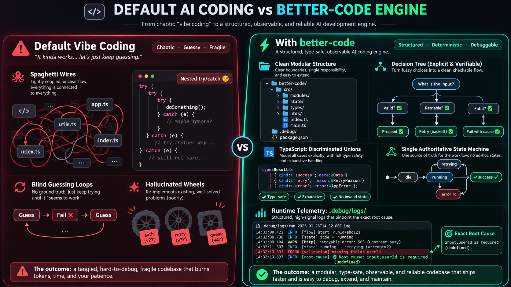
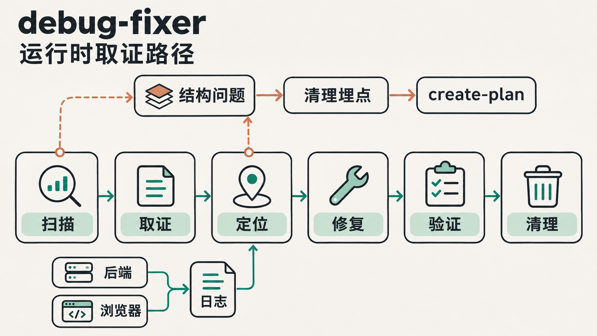

<div align="center">

# ⚡ better-code

**告别“胶水代码”与“盲猜打补丁” —— 面向 Claude Code 的全生命周期高内聚工程引擎**

*An Opinionated, High-Cohesion Software Engineering Workflow Plugin for Claude Code*

<p align="center">
  
  
  
  
</p>

<p align="center">
  
</p>

</div>

---

## 💡 为什么需要 `better-code`？

默认状态下的 AI 辅助编程（Vibe Coding）在写 Demo 时很快，但一旦进入真实工程，往往会陷入 **7 大顽疾**：

1. **闭门造车与单一语言偏见**：遇到难题直接用当前语言硬写残次品，无视全网现成的跨语言引擎（如 `yt-dlp`、`ffmpeg`）或藏在技术博客、X (Twitter)、Issue 角落里的破局技巧。
2. **需求没想透就闷头写代码**：方向本身是错的，或者抛出十几个细枝末节的问题让开发者疲于应付。
3. **散装文件与胶水代码（Spaghetti Glue Code）**：新文件平铺堆在同一目录，新旧入口各自维护状态，到处是只做转发的空壳 `Service/Manager`（假封装）。
4. **防御性 `try-catch` 泛滥**：为了“不报错”，在业务中间层层层套 `try-catch` 吞掉异常返回 `null`，把第一故障现场彻底掩盖。
5. **假按需加载与主线程卡死**：外层写了动态 `import()`，入口却从 `index.ts` barrel 静态全量导入；误以为给函数加上 `async` 就能把同步重 CPU 计算移出主线程。
6. **盲猜式修 Bug（Guess → Fail → Guess）**：遇到疑难 Bug 靠猜，改一处坏三处，用满屏 `console.log` 污染代码库。
7. **跨会话失忆与烂尾工作区**：新开一个会话又犯同样的架构错误，计划做完不更新、临时分支不清理。

**`better-code` 不是一堆零散提示词的拼盘，而是一套环环相扣的“工程护栏系统”**——将顶尖架构师的**跨界调研、苏格拉底式决策树追问（Grill-Me）、模块化设计、强类型契约、实证埋点排障与代码审查**注入到 Claude Code 的每一步动作中。

<p align="center">
  
</p>

---

## 🧭 全景架构：9 大核心技能（4 阶闭环 + 全程记忆守护）

`better-code` 由 **1 个全程守护的工程记忆中枢（`doc-memory`）** 与 **4 个阶段的 8 个核心业务技能** 组成。它们既可以按任务复杂度**独立按需调用**，也可以串联成一条从 `0 → 1` 的严密研发流水线：

### 🏛️ 全程守护层：跨会话结构化记忆

| 技能命令 | 核心职责与设计机制 | 沉淀产物 |
| :--- | :--- | :--- |
| **`/doc-memory`** | **三级渐进式工程记忆库**<br>• 会话首任务自动读取 `index.md` 路由表，按需匹配加载 `1~3` 条相关历史红线，拒绝全量读取撑爆上下文<br>• 当用户纠正错误做法或踩坑后，自动归类沉淀可执行规则，让 Agent 越用越懂你的工程 | `docs/memory/index.md`<br>`docs/memory/<category>/*.md` |

### 🟢 第一阶段：探索与破局（Explore & Spark）

| 技能命令 | 核心职责与设计机制 | 沉淀产物 |
| :--- | :--- | :--- |
| **`/research`** | **跨语言全网与社区角落深度调研（Deep Research）**<br>• **打破语言壁垒**：提炼跨语言高星项目的核心架构与算法，或通过 CLI / Sidecar / RPC / WASM 直接复用成熟引擎<br>• **四层搜索矩阵 + 两跳深挖**：覆盖 GitHub 标杆、深度技术长文、**X (Twitter) / Reddit / HN / V2EX / Issue 角落野生方案**及反方踩坑证据（Devil's Advocate） | `docs/research/<topic>/00-summary.md`<br>及分卷明细报告 |
| **`/spark`** | **多轴线头脑风暴 + Grill-Me 设计决策树追问**<br>• **编码硬门禁**：方案拍板前严禁写业务代码；先静默摸底代码库与调研报告，绝不拿已知事实烦用户<br>• **四段式视觉契约**：每轮清晰展示决策树进度（`[✓ 已敲定]` / `[▶ 当前推演]` / `[⏳ 待推演]`）、正交路线对比与 **ASCII 架构草图**<br>• **堵死 AI 偷懒后门**：每次提问自带 `[推荐]` 方案；用户放权说“你来定”时强制触发**《自问自答深度推演（Self-Grill Protocol）》** | `docs/specs/<topic>.md`<br>*(含淘汰账本 Reject Ledger)* |

### 🟡 第二阶段：工程规划与架构把关（Plan & Audit）

| 技能命令 | 核心职责与设计机制 | 沉淀产物 |
| :--- | :--- | :--- |
| **`/create-plan`** | **零上下文可交接的完整实施计划**<br>• **模块化目录树先行**：强制按领域职责划分子目录，消灭散装堆放文件<br>• **SDK 复用与五项封装要素**：明确 SDK 与本地代码边界、函数签名与强类型契约、目标调用链与旧职责退出点<br>• **内置性能、安全与高可用检测**：覆盖首屏静态导入链、Worker 释放、路径防穿越、原子写入与 `S0` 前置探针 | `docs/plans/<slug>.md` |
| **`/plan-review`** | **直击要害的结构化计划审核**<br>• 审核者先主动判断应采用什么模块划分、设计模式与 SDK，再严厉拦截透传外壳（假封装）、双轨状态中心与假懒加载<br>• **三段式直观反馈**：一眼看清 **① 这个计划是否允许执行（含 `S0/S1` 阶段就绪分离）**、**② 哪些地方涉及风险**、**③ 具体需要改动哪些地方** | 结构化审核报告<br>*(支持 `R1/R2` 复审闭环追踪)* |

### 🔵 第三阶段：高内聚编码与实证排障（Build & Fix）

| 技能命令 | 核心职责与设计机制 | 沉淀产物 |
| :--- | :--- | :--- |
| **`/better-code`** | **高内聚设计落地与编码引擎（支持 `worktree` 隔离）**<br>• 支持 `/better-code worktree` 在独立 Git Worktree 中零污染编码<br>• **用强类型消灭防御性 `try-catch`**：入口执行 `Parse, don't validate`，预期业务分支使用可辨识联合类型（Discriminated Union），仅在 4 类合法边界允许 `try-catch`<br>• **小改动自动升级阀门**：局部小改走高可用快车道；探查发现架构耦合或未知风险时自动升级至 `/create-plan` | 高内聚业务代码 +<br>行为与结构双验收证据 |
| **`/debug-fixer`** | **实证驱动的自动化埋点排障引擎**<br>• **一次静态猜测铁律**：静态直修最多 1 次，失败立即回滚并转入运行时埋点取证，严禁盲目打补丁<br>• **双层重构止损门禁**：静态扫描或日志分析发现属于架构烂账（状态分裂、职责耦合）时，自动清空埋点并升级至 `/create-plan`<br>• **前后端双通道落盘 + 一键零残留清理**：后端本地 JSONL 追加写入、前端通过 `:9220` 本地服务汇聚至 `.debug/logs/`，修完自动清除所有 `#region DEBUG` 块 | 源头修复代码<br>*(零调试残留)* |

### 🟣 第四阶段：交付审查与归档封版（Verify & Wrap）

| 技能命令 | 核心职责与设计机制 | 沉淀产物 |
| :--- | :--- | :--- |
| **`/code-review`** | **沿真实触发路径的代码终检**<br>• 全量覆盖未暂存、暂存区（`--cached`）与未跟踪新文件<br>• 专项猎杀异步 `A → B` 切换乱序覆盖竞态、被静态 `barrel` 导入击穿的假懒加载、`async` 同步重计算阻塞主线程、以及缺失对象级鉴权（`actor.id === record.ownerId`）的越权漏洞 | 分级代码审查结论与最小修正方案 |
| **`/wrap`** | **计划只读归档 + Worktree 合并清理 + 安全提交**<br>• 将已完成计划更新状态并迁入 `docs/plans/archive/` **永久锁定为只读档案**<br>• 核查凭证安全后创建语义化 Commit；若使用了 `worktree`，自动合并回目标分支并卸载清理临时工作树 | 干净的主分支提交 +<br>`docs/plans/archive/*.md` |

---

## 🔬 核心亮点深潜

### 1. 实证驱动的 `/debug-fixer`：彻底终结“猜 → 错 → 再猜”死循环

普通 AI 修复杂 Bug 时，往往在同一个函数里翻来覆去加 `if (x != null)` 和 `try-catch`，越改越烂。`/debug-fixer` 强制执行一套像资深架构师一样的排障流水线：

<p align="center">
  
</p>

- **双层“重构止损门禁（Refactoring Gate）”**：在 **Step 1（四维静态扫描）** 和 **Step 4（拿到运行时日志后）** 各设一道门禁——一旦证实故障源于“同一状态在 ≥3 处散落读写”或“模块契约根本冲突”，立即停止单点打补丁，清理埋点后直接呼叫 `/create-plan` 做模块化重构。
- **7 种语言标准静默埋点**：内置 Node/TS、Browser、Python、Go、Java、Rust、PHP、Ruby 标准埋点模板，通过调用链二分法（每次 ≤3 处）精准捕获 `input`、`branch`、`state_change/visual` 与 `output`，定位**首个数据/样式偏离源头**。

### 2. 用强类型契约根治 AI 的 `try-catch` 依赖症

为什么 AI 喜欢到处写 `try-catch`？因为它对上下游数据形状和错误责任没有安全感。`/create-plan`、`/better-code` 与 `/code-review` 联合强制执行以下铁律：

- **Parse, don't validate（在入口收窄类型）**：在系统边界一次性完成原始输入校验并收敛为强领域类型，内部核心函数不再写防御性空值猜测。
- **用判别联合类型（Discriminated Union）表达预期分支**：如 `{ ok: true, data } | { ok: false, reason: 'tooLate' | 'invalid' }`，由编译器强制调用方处理分支，严禁把返回类型放宽为 `T | null` 配合 `catch { return null }` 吞错。
- **仅在 4 类合法边界写 `try-catch`**：① 本地资源回滚/释放（`finally` 或清理后重抛）；② 跨模块边界补充业务上下文（保留原始 `cause`）；③ 有界幂等重试与非核心降级；④ 顶层统一错误出口。

---

## 🚀 快速安装与使用

### 1. 安装插件

**从 GitHub 一键安装（Claude Code ≥ 2.1.275）：**

```text
/plugin install better-code --marketplace bb-boy680/better-code
```

也可以在会话中分两步添加 marketplace 再安装：

```text
/plugin marketplace add bb-boy680/better-code
/plugin install better-code@better-code
```

**本地开发调试：** 直接挂载插件目录：

```bash
claude --plugin-dir /path/to/better-code
```

安装后，技能以 `better-code:<skill>` 的形式出现，例如 `/better-code:code-review`；模型也会按 `description` 自动触发。

*(你也可以将 `AGENTS.md` / `CLAUDE.md` 中的工程规则合并到你项目的根目录说明中，以激活自动会话记忆与只读归档保护。)*

### 2. 典型实战工作流示例

#### 场景 A：从 0 到 1 打造复杂新产品 / 攻克陌生领域
```text
# 1. 先跨语言全网深挖现成引擎、文章原理与社区/X 角落里的野生技巧
/better-code:research 多渠道剪贴板监听自动下载视频方案

# 2. 基于调研报告进行多轴线碰撞与 Grill-Me 决策树追问，拍板设计规格
/better-code:spark 设计多渠道剪贴板视频下载器

# 3. 生成包含模块化目录树、SDK 复用与分阶段验收的完整计划
/better-code:create-plan

# 4. 审核计划风险与必改项，确认是否允许执行
/better-code:plan-review docs/plans/clipboard-video-downloader.md

# 5. 开启独立 git worktree 隔离落地高内聚代码
/better-code:better-code worktree docs/plans/clipboard-video-downloader.md

# 6. 终检代码并发、越权与按需加载，通过后一键归档计划并合并清理 worktree
/better-code:code-review
/better-code:wrap docs/plans/clipboard-video-downloader.md
```

#### 场景 B：日常功能开发与重构（自动按复杂度分流）
```text
# 直接调用 /better-code，简单修改走高可用快车道，复杂改造自动升级规划
/better-code:better-code 为报表导出模块新增流式 PDF 导出并支持中途取消
```

#### 场景 C：疑难 Bug 实证排障
```text
# 自动四维扫描 → 判断是否需重构 → 前后端埋点复现抓日志 → 修复源头并自动清理埋点
/better-code:debug-fixer 快速切换文档时偶发旧文档内容覆盖新文档，且流程图放大到 100% 后尺寸卡死
```

---

## 📂 仓库结构与工程文档约定

使用 `better-code` 工作流时，项目内产生的知识与工程资产会井然有序地沉淀在 `docs/` 下：

```text
your-project/
├── docs/
│   ├── memory/                  # [/doc-memory] 跨会话结构化工程经验库
│   │   ├── index.md             #   ├─ 分类路由索引（会话启动仅读此索引）
│   │   └── <category>/*.md      #   └─ 按需加载的独立经验条目
│   ├── research/                # [/research] 全网跨语言与社区深度调研报告
│   │   └── <topic-slug>/
│   │       ├── 00-summary.md
│   │       ├── 01-existing-solutions-and-sdks.md
│   │       └── 02-articles-community-and-pitfalls.md
│   ├── specs/                   # [/spark] 拍板的设计规格说明书（含淘汰账本）
│   │   └── <topic-slug>.md
│   └── plans/                   # [/create-plan & /wrap] 实施计划与只读历史归档
│       ├── <active-plan>.md     #   ├─ 当前执行中的计划
│       └── archive/             #   └─ 已完成并锁定的只读归档计划（严禁篡改）
└── .debug/logs/                 # [/debug-fixer] 运行时临时埋点日志（修复后自动清理零残留）
```

---

## 🛠️ 插件校验

```bash
claude plugin validate . --profile directory
```

## 📄 License

MIT © 黑黑的脸蛋
