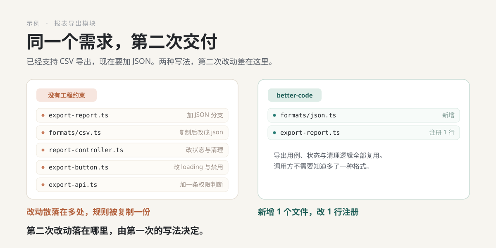

# better-code

**让 AI 写出更高质量的代码。**

better-code 是一个 Claude Code 插件。它在 Claude 动手写代码时持续施加工程约束：职责放在哪、边界划在哪、重规则只留一份、改动落在哪一层。

这里的「高质量」不是「看起来整洁」，而是可以检验的：功能是否真的做对，错误和状态有没有明确的处理人，以及**下次同类修改要动几个文件**——最后一条，是前两条能不能长期维持的证据。



## 一次生成几十个文件之后，质量靠什么保证

写出来很快，已经不是难事。难的是两周后加一个同类需求时，你发现要改的是这些地方：

- 查询、校验、编码、写盘全在同一个函数里，加一种输出格式就要动整条链；
- 同一条权限规则被复制到三个入口，改一处漏两处；
- 类型声明写得很全，但业务结果和异常混在一起，调用方只能 try-catch 兜住一切；
- 改动通过评审时没人说得清：为什么这样分层、为什么这里要拆，下次只能照抄或推翻重来。

这些不是生成速度的问题，是**质量没有被约束**的问题。better-code 把这类约束写进 Claude 的工作流程，让它在动手前先确定边界，在交付前先检查下一次修改的成本。

## 安装

在 Claude Code 会话中执行：

```text
/plugin marketplace add bb-boy680/better-code
/plugin install better-code@better-code
```

若你的版本支持 `--marketplace` 参数，也可以合并成一条：

```text
/plugin install better-code --marketplace bb-boy680/better-code
```

安装后在任意项目里就能用，不需要改项目配置。会话内输入 `/plugin` 可管理已安装插件。

## 第一次使用

在项目目录启动 Claude Code，用主技能描述要实现的内容。例如给已有订单列表加导出能力：

```text
/better-code:better-code 为订单列表增加 CSV 导出。
复用现有查询和权限校验，将导出流程与格式编码分开，补齐相关验证。
```

它会先读现有代码、调用方和依赖，再按任务复杂度完成必要的设计与实现，交付时说明改了哪些文件、职责如何划分、跑了哪些检查、哪些内容尚未验证。之后加 JSON 导出时，变化应集中在格式实现和一个选择入口上——这正是上面那张图在演示的事。

还可以直接这样用：

```text
/better-code:better-code 重构报表导出模块，集中状态与清理逻辑，保留已有功能。
```

```text
/better-code:code-review 检查当前改动的模块边界、重复规则、错误处理和回归风险。
```

小改动不必走完整流程。已有计划时传入计划路径；需要隔离工作区时加 `worktree`：

```text
/better-code:better-code docs/plans/report-export.md
/better-code:better-code worktree docs/plans/report-export.md
```

## 判断是否适合你

| 适合 | 不太适合 |
| --- | --- |
| 用 Claude Code 写跨文件的功能或重构 | 一次性脚本、临时 demo |
| 被 AI 生成的胶水代码返工过 | 只想要更快的补全速度 |
| 需要在交付时说清「为什么这样分层」 | 已经有严格架构规范并由 CI 强制 |

## 它检查什么

每条约束都对应技能里可执行的判断标准，不是口号：

| 关注点 | 写代码时的要求 |
| --- | --- |
| 模块边界 | 按职责组织代码，让一起变化的规则放在一起 |
| 业务规则 | 校验、状态迁移和执行顺序各有明确归属，不靠复制保持一致 |
| 类型与错误 | 在边界校验输入，业务结果与异常分别有处理人；只有真正的边界才允许 try-catch |
| 现有能力复用 | 先查项目实现与依赖版本，复用合适的模块和 SDK，不手写重复能力 |
| 加载与执行 | 核对重模块是否真的按需加载、重计算是否阻塞主线程 |
| 验证与维护 | 除了行为测试，也检查结构：下次同类修改要改几个文件 |

设计规模与问题相称：职责清楚的小功能用简单函数即可；出现多种格式、复杂状态或外部协议差异时，再引入对应抽象。完整标准见 [better-code 技能](skills/better-code/SKILL.md)。

### 例如：给导出功能增加一种格式

已经支持 CSV，现在要加 JSON。先明确三个职责：

- **导出用例**：查询、编码、写入的顺序，以及失败或取消后的清理；
- **格式实现**：只负责把数据编码成 CSV 或 JSON；
- **数据与存储接口**：复用已有查询和写入能力。

```text
export/
├── export-report.ts    # 导出用例：顺序、状态与清理
├── formats/
│   ├── csv.ts          # CSV 编码
│   └── json.ts         # JSON 编码
└── export-report.test.ts
```

验收时除了确认 JSON 能正确导出，还要检查：调用方是否确实走统一流程、原有 CSV 行为是否保持、UI 或控制器里是否残留另一套状态与清理逻辑。**如果还需要在多个地方复制查询、校验和清理，说明边界没划对。**

## 九个技能，按需取用

调用格式为 `/better-code:<技能名> <任务描述>`，点击技能名可查看完整规则。多数改动只用到其中一两个。

| 你会这样说 | 技能 | 它产出什么 |
| --- | --- | --- |
| 「实现这个功能」「重构这个模块」 | [better-code](skills/better-code/SKILL.md) | 代码改动、行为与结构验证 |
| 「先聊下怎么设计」「帮我理清需求」「别顺着我」 | [spark](skills/spark/SKILL.md) | 设计规格与关键决定 |
| 「调研一下有没有现成方案」 | [research](skills/research/SKILL.md) | 有来源的调研与方案比较 |
| 「先做计划」「拆解开发阶段」 | [create-plan](skills/create-plan/SKILL.md) | 模块划分、实施步骤与验收计划 |
| 「审一下这个计划能不能开工」 | [plan-review](skills/plan-review/SKILL.md) | 风险、缺口与修订建议 |
| 「检查有没有 Bug」「是否偏离计划」 | [code-review](skills/code-review/SKILL.md) | 有触发条件和证据的审查结论 |
| 「这里偶发异常，定位一下」 | [debug-fixer](skills/debug-fixer/SKILL.md) | 根因证据、修复与验证记录 |
| 「收尾」「归档计划」「提交并合并」 | [wrap](skills/wrap/SKILL.md) | 计划归档、提交与按需合并清理 |
| 「记住这条规则」「查看工程记忆」 | [doc-memory](skills/doc-memory/SKILL.md) | 分类索引与独立经验条目 |

`code-review` 默认只读；需要修改时明确提出修复或重构任务。

## 复杂任务怎样衔接

新产品、跨模块改造或技术路线未定时，可以把技能串起来：

```text
research → spark → create-plan → plan-review → better-code → code-review → wrap
```

调研找到可复用方案，设计和计划明确边界，编码把决定落进真实调用路径，审查与收尾核对交付。`doc-memory` 不占阶段顺序，按需读写；排查运行时异常时插入 `debug-fixer`。


<details>
<summary>运行时异常：先拿证据，再改代码</summary>

当问题需要复现和日志确认时，`debug-fixer` 提供受控埋点、证据分析、修复验证与调试代码清理。证据不足时不做猜测性修改；若根因是职责耦合或状态分裂，会先清理埋点，转入重构规划而不是在旧结构上继续打补丁。

```text
/better-code:debug-fixer 快速切换文档时，偶发旧请求结果覆盖当前文档，请定位原因并验证修复。
```


</details>

## 使用说明与边界

- **适用环境**：Claude Code 插件。技能会使用当前会话可用的文件、终端和检索工具；调研、浏览器验证等任务需要对应工具支持。
- **明确调用**：示例均为 `/better-code:<技能名>` 显式调用。Claude 也会根据技能描述自行判断何时加载；需要固定流程时直接调用更可靠。
- **它是约束，不是证明**：技能指导模型怎么实施、怎么自查。最终质量仍要由项目自己的测试、类型检查、构建和人工评审确认——一份说明不能当作「检查已通过」的证据。
- **记忆需要接入**：经验默认写入 `docs/memory/index.md` 与独立主题文件。希望每次会话先读历史规则，需要把这条要求写进目标项目的 `CLAUDE.md`；本仓库的项目规则不会随安装自动生效。
- **`wrap` 会动 Git**：验证通过后它会归档计划并提交，使用工作树时还涉及合并与清理。调用前明确任务范围和目标分支，远程推送另行授权。
- **更新与卸载**：`claude plugin update better-code` 更新，`claude plugin uninstall better-code` 卸载。

<details>
<summary>工作流文档默认保存在哪里</summary>

沿用目标项目已有约定；未指定时使用以下默认位置，且只在任务需要时生成。

| 内容 | 默认位置 |
| --- | --- |
| 调研结论 | `docs/research/` |
| 设计规格 | `docs/specs/` |
| 实施计划 | `docs/plans/` |
| 已完成计划 | `docs/plans/archive/` |
| 工程经验 | `docs/memory/` |
| 排障日志 | `.debug/logs/` |

已归档的计划按只读历史对待；后续改造新建计划，并引用历史文档。

</details>

## 本地开发与校验

```bash
git clone https://github.com/bb-boy680/better-code
claude --plugin-dir ./better-code
```

在仓库根目录校验结构：

```bash
claude plugin validate . --profile directory
```

插件描述位于 [.claude-plugin/plugin.json](.claude-plugin/plugin.json)，marketplace 配置位于 [.claude-plugin/marketplace.json](.claude-plugin/marketplace.json)，各技能入口为 `skills/<技能名>/SKILL.md`。

## License

[MIT](LICENSE) © 黑黑的脸蛋
